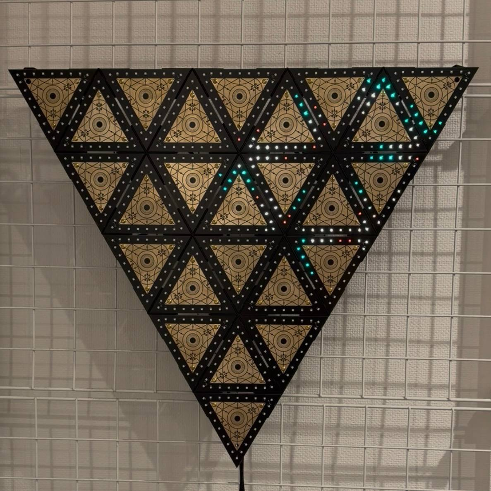
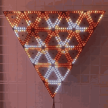
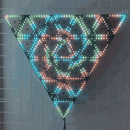
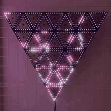
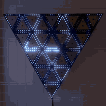
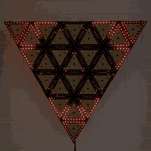

# Triangel!

ART!!! Made of 25 triangle tiles and 600 LEDs, for a wall or the corner of a room, with pleasing ambient patterns and exciting audio-reactive patterns specially tuned to follow music.

<table align="center">
  <tr>
    <td align="center"> Flame</td>
    <td align="center"> Uzumaki</td>
    <td align="center"> Fubuki</td>
    <td align="center"> Raindrop (sound)</td>
    <td align="center"> Spectrum (sound)</td>
  </tr>
</table>

- 50 cm per side when assembled
- 14 patterns: slow ambient ones, and ones that move with the beat, the drops and the shape of the music
- Audio-reactive mode: set on/off or auto-detected when music is playing
- Controlled by: buttons, a sound switch or a remote; no app/connected computer needed
- Open source: the circuit boards, the brackets and the firmware are all here, in Rust, on two [dabao](https://www.crowdsupply.com/baochip/dabao) boards using the [Baochip-1x](https://github.com/baochip/baochip-1x), running [Xous](https://github.com/betrusted-io/xous-core)

You don't need a Triangel to write patterns for it: one dabao board and a browser will do. [Start here](docs/tutorials/first-run.md).

## Why the name?

Each triangle tile has a stylized eye design in the middle.. After I decided to cover it in eyes, I was inspired/by biblical angel descriptions to name it... triangle + angel = Triangel!

## Where to go

### If you have a Triangel

- [Use your Triangel](USER_GUIDE.md#controls): the controls
- [Update its firmware](docs/how-to/update-your-triangel.md)
- [Make a dabao start by itself](docs/how-to/make-a-dabao-start-by-itself.md), after replacing one
- [Print the stickers and overlays](graphics/README.md)

### If you want to develop

- **Learn**
  - [Build and preview Triangel patterns with one dabao](docs/tutorials/first-run.md): start here if you are new, or don't have Triangel hardware
  - [Write your first pattern](docs/tutorials/first-pattern.md)
  - [Write a sound pattern](docs/tutorials/first-sound-pattern.md)
- **How to**
  - **Get set up**
    - [Set up your machine](docs/how-to/set-up-a-development-machine.md)
    - [Build the firmware and flash the boards](docs/how-to/build-and-flash.md)
    - [Make a dabao start by itself](docs/how-to/make-a-dabao-start-by-itself.md)
    - [Watch the patterns in a browser](docs/how-to/run-the-previewer.md)
  - **Work on patterns**
    - [Add a pattern](docs/how-to/add-a-pattern.md)
    - [Make a pattern fast enough](docs/how-to/make-a-pattern-fast-enough.md)
    - [Tune the sound response](docs/how-to/tune-the-sound-response.md)
  - **Hardware and the deeper parts**
    - [Check a microphone that is not working](docs/how-to/check-the-microphone.md)
    - [Change the microphone's pins](docs/how-to/regenerate-the-mic-program.md)
    - [Regenerate the LED map](docs/how-to/regenerate-the-led-map.md)
    - [Build the kernels](docs/how-to/build-the-kernels.md)
- **Understand**
  - [How Triangel works](docs/explanation/how-triangel-works.md): the parts, the two boards, a frame, the setlists and the kernel
  - [How sound becomes light](docs/explanation/how-sound-becomes-light.md): from the microphone, through the 24 bands, to beats and drops
- **Look things up**
  - [Pattern toolkit](docs/reference/pattern-toolkit.md): the helpers, the measurements and the sound
  - [Triangle tiles and wiring](docs/reference/triangle-tiles-and-wiring.md): the layout, the numbering and the two chains
  - [Pins](docs/reference/pins.md): which dabao pins each board uses
  - [The ear-to-eye link](docs/reference/ear-to-eye-link.md): the frames the ear sends, byte by byte
  - [Diagnostic output](docs/reference/diagnostic-output.md): the status lines the eye and the ear can print, for troubleshooting
  - [Contributing](CONTRIBUTING.md)

## What is in this repository

| Folder | Contents |
|---|---|
| [`firmware/eye/`](firmware/eye/) | The eye's firmware: LED output, patterns, controls |
| [`firmware/ear/`](firmware/ear/) | The ear's firmware: microphone, frequency bands, the link to the eye |
| [`firmware/shared/`](firmware/shared/) | Code both use: the format of what the ear sends, and the sound tuning |
| [`triangel-previewer/`](triangel-previewer/) | Shows the eye's LED output in a browser |
| [`hardware/`](hardware/) | The circuit boards (KiCad) and the brackets |
| [`graphics/`](graphics/README.md) | Artwork and the sticker sheets |

## License

MIT. See [LICENSE](LICENSE).
