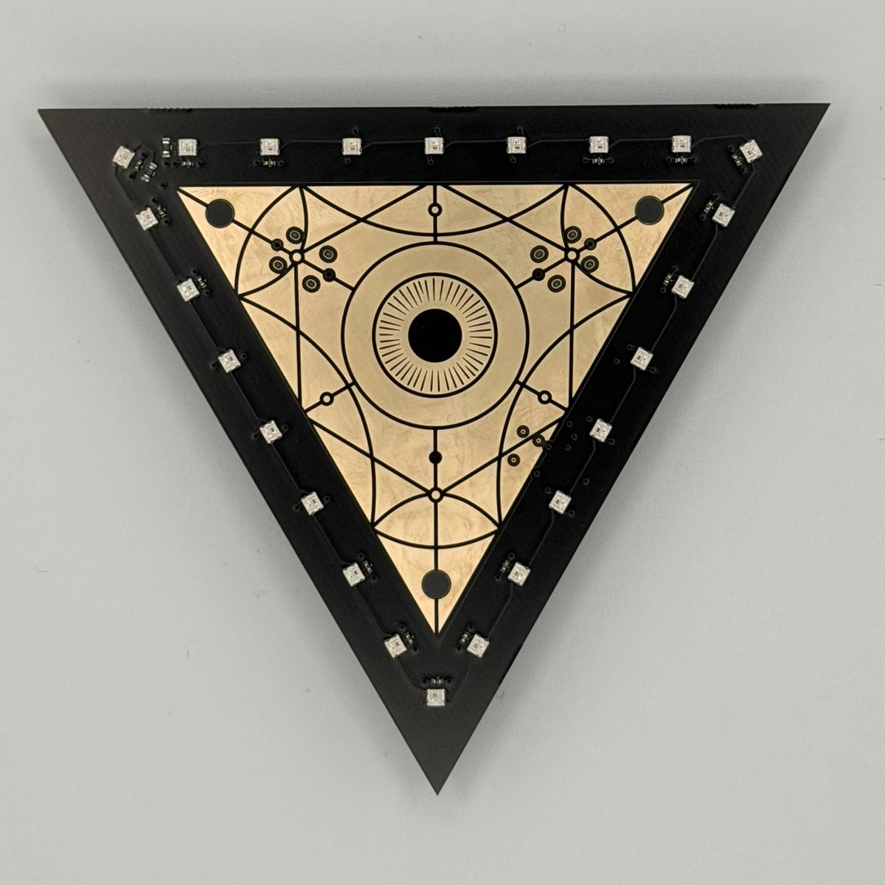
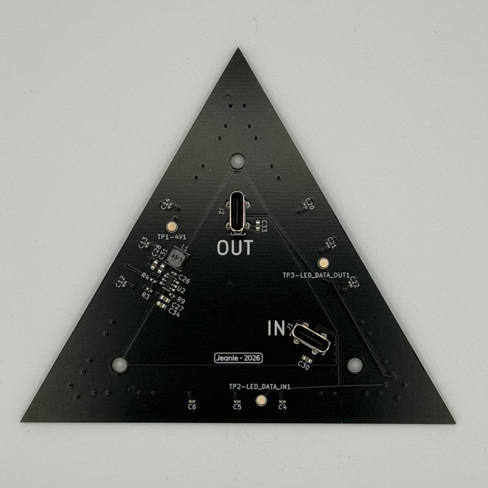
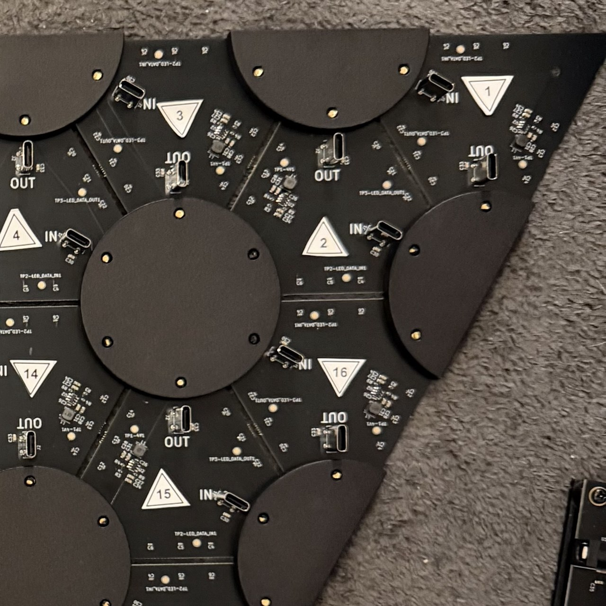

# Triangle tiles and wiring

How the 25 triangle tiles are laid out, numbered and wired.

## A triangle tile

Each triangle tile is a triangle circuit board, 10 cm on a side, with 24 LEDs around its edge.

<p align="center"></p>

On the back are two USB-C connectors, **IN** and **OUT**. The cables between triangle tiles carry 12 V power and the LED data together: data comes in on IN, runs through the 24 LEDs, and goes out on OUT to the next triangle tile.

<p align="center"></p>

The LEDs are numbered D1 to D24 on the board. Seen from the front with the triangle tile point up, D1 is the bottom-left corner, D9 the bottom-right corner and D17 the top corner, and the numbers run around the edge in that order.

## Layout and numbering

The triangle tiles form one large triangle, point down, which mounts across the corner of a room. They are numbered in the order the data runs through them, snaking back and forth: row 1 left to right, row 2 right to left, and so on. Seen from the front, the side with the LEDs:

```
 1   2   3   4   5   6   7   8   9
    16  15  14  13  12  11  10
        17  18  19  20  21
            24  23  22
                25
```

In each row the triangle tiles alternate: the first one points down, the next up, and so on. Triangle tile 25, at the bottom, points down into the corner of the room. There is a 2 mm gap between neighboring triangle tiles.

Turn each triangle tile so that its OUT connector is toward its point. Seen from the back, everything is mirrored: triangle tile 1 is at the top right.

<p align="center"></p>

If you like, print the numbered stickers in [graphics](../../graphics/README.md) to mark each triangle tile's number during assembly. Each sticker is a small triangle that points the same way as its triangle tile.

## Wiring

The data runs through the triangle tiles in number order, so each cable only has to reach the next triangle tile. It is split into two chains that the eye drives at the same time, which about halves the time to send a frame:

| Chain | Controller board port | Eye pin | Triangle tiles | LEDs |
|---|---|---|---|---|
| 1 | OUT TO 1-12 | PC10 | 1 to 12 | 288 |
| 2 | OUT TO 13-25 | PC9 | 13 to 25 | 312 |

These are the v3 controller's pins. The v1 controller uses different ones, so check the [`boards-v1` tag](https://github.com/rowr111/triangel/tree/boards-v1); for v2, see [Pins](pins.md#the-eye).

## LED order in the firmware

`LED_MAP`, and the frame a pattern fills in, go in wiring order: triangle tile 1 to 25, and D1 to D24 within each. `out[i]` is the color of `LED_MAP[i]`, and LEDs 0-287 are chain 1, 288-599 chain 2.

To change any of this, see [How to regenerate the LED map](../how-to/regenerate-the-led-map.md).
