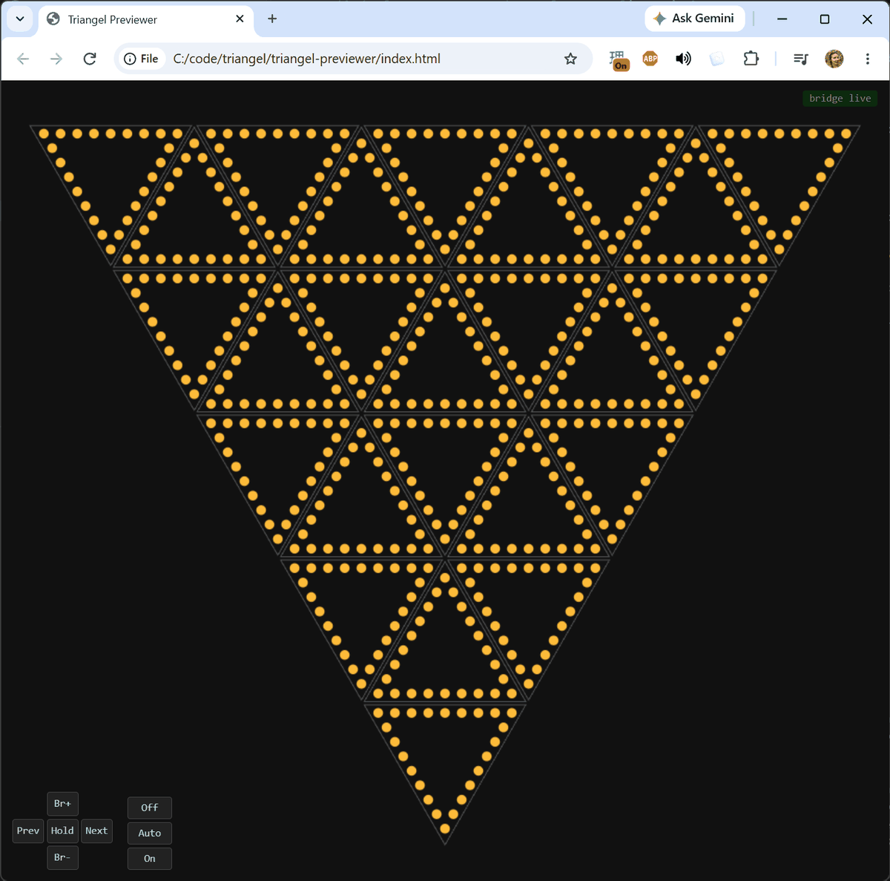
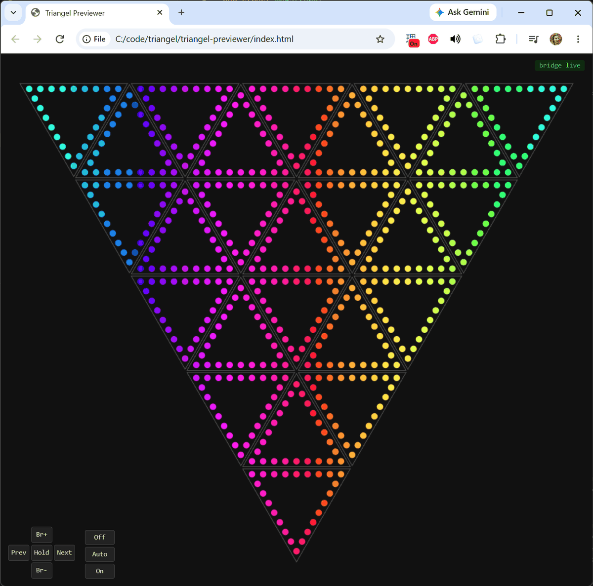

# Your first pattern

In this tutorial you will write a pattern of your own, watch it in the previewer, and change it a few times until it moves across the Triangel.

## Before you start

Do [Your first run](first-run.md) first. You need the same dabao, with the bridge running and the previewer open in your browser. Leaving the previewer running is fine: it reconnects by itself each time you flash.

## 1. Create the pattern

A pattern is a piece of code the eye calls about 30 times a second. Each time, it fills in a color for every one of the 600 LEDs.

Create the file `firmware/eye/src/patterns/ambient/my_pattern.rs` with this in it:

```rust
use crate::audio::Audio;
use crate::patterns::{Frame, Pattern, hsv};

pub struct MyPattern;

impl Pattern for MyPattern {
    fn render(&mut self, _t_ms: u32, _audio: &Audio, out: &mut Frame) {
        // Every LED orange.
        out.fill(hsv(30.0, 1.0, 1.0));
    }
}
```

`render` is the part the eye calls. `out` holds the colors it fills in. `hsv` makes a color from a place on the color wheel (0 to 360, where 30 is orange), how strong the color is (0 to 1) and how bright it is (0 to 1).

## 2. Add it to the setlist

The eye only plays patterns it knows about. Two small edits tell it about yours.

In `firmware/eye/src/patterns/ambient/mod.rs`, add a line for the new file:

```rust
pub mod my_pattern;
```

In `firmware/eye/src/setlist.rs`, add `my_pattern::MyPattern` to the list of ambient patterns it uses:

```rust
use crate::patterns::ambient::{drizzle::Drizzle, effervesce::Effervesce, flame::ApexFlame, fubuki::Fubuki, my_pattern::MyPattern, rainbow::Rainbow, ricochet::Ricochet, shimmer::CenterShimmer, squall::Squall, uzumaki::Uzumaki};
```

Then, in the same file, put it first in `ambient_patterns()`, so it is the pattern you see when the eye starts:

```rust
fn ambient_patterns() -> Vec<Box<dyn Pattern>> {
    vec![
        Box::new(MyPattern),
        Box::new(Fubuki::new()),
        ...
```

## 3. Build, flash and look

Press **RESET** on the dabao. The drive appears. Then click **Build - Flash - Boot**, the last item in the Baochip sidebar. It builds, flashes and starts the firmware in one go.

> **Or, instead, from the command line:** from `firmware/eye`, run
>
> ```
> cargo build --release --features previewer
> xous-app-uf2 --elf target/riscv32imac-unknown-xous-elf/release/eye
> ```
>
> Press **RESET**, copy `apps.uf2` onto the drive, then press **PROG**. The kernel files are already on the dabao from the first run, so only `apps.uf2` needs copying.

In the browser, the status goes to `no frames` for a moment and back to `bridge live`. The whole Triangel is orange.

<p align="center"></p>

> [!NOTE]
> If your dabao starts its firmware at power-up, RESET only restarts it. Hold **PROG** while you press **RESET**, or while you plug it in.

## 4. Make it change over time

`t_ms` is the time in milliseconds. Use it to move around the color wheel. Change `render` to:

```rust
    fn render(&mut self, t_ms: u32, _audio: &Audio, out: &mut Frame) {
        // Once around the color wheel every 10 seconds.
        let hue = cycle(t_ms, 10_000) * 360.0;
        out.fill(hsv(hue, 1.0, 1.0));
    }
```

`cycle` gives how far through a repeating period the time is, from 0 to 1. Add it to the `use` line at the top:

```rust
use crate::patterns::{Frame, Pattern, cycle, hsv};
```

Build and flash again. The whole Triangel now fades slowly through every color.

## 5. Make it depend on where each LED is

So far every LED gets the same color. To give each LED its own, look up where it is. `LED_MAP` lists every LED with its position in millimeters: `wx` from left to right and `wy` from top to bottom.

Replace the whole file with:

```rust
use crate::audio::Audio;
use crate::led::map::LED_MAP;
use crate::led::world::{WORLD_LEFT, WORLD_RIGHT};
use crate::patterns::{Frame, Pattern, cycle, hsv};

pub struct MyPattern;

impl Pattern for MyPattern {
    fn render(&mut self, t_ms: u32, _audio: &Audio, out: &mut Frame) {
        // Once around the color wheel every 10 seconds.
        let shift = cycle(t_ms, 10_000);
        for (i, led) in LED_MAP.iter().enumerate() {
            // How far across the Triangel this LED is: 0 at the left edge, 1 at the right.
            let across = (led.wx - WORLD_LEFT) / (WORLD_RIGHT - WORLD_LEFT);
            out[i] = hsv((across + shift).fract() * 360.0, 1.0, 1.0);
        }
    }
}
```

`out[i]` is the color of `LED_MAP[i]`. `WORLD_LEFT` and `WORLD_RIGHT` are the Triangel's left and right edges. Adding `shift` moves the colors along over time, and `fract()` keeps the result between 0 and 1.

Build and flash. A rainbow now runs across the Triangel from left to right, and scrolls.

<p align="center"></p>

## 6. Make it your own

Try a few changes, building and flashing after each one:

- **Speed:** change `10_000` to `3_000` for a faster scroll, or `60_000` for a slow one.
- **Direction:** run the colors from top to bottom instead. Change the `use` lines for the map and the edges to:

  ```rust
  use crate::led::map::{LED_MAP, WORLD_H, WORLD_TOP};
  ```

  and delete the `use crate::led::world::...` line, which is no longer needed. Then change the loop to use each LED's `wy`, its distance from the top:

  ```rust
  for (i, led) in LED_MAP.iter().enumerate() {
      // 0 at the top, 1 at the bottom point.
      let down = (led.wy - WORLD_TOP) / WORLD_H;
      out[i] = hsv((down + shift).fract() * 360.0, 1.0, 1.0);
  }
  ```

- **Fewer colors:** a full rainbow is a lot. Keep to part of the color wheel, such as the blues and purples from 200 to 280. To avoid a hard edge where 280 jumps back to 200, swing back and forth instead of going around. Change the `out[i] = ...` line in the loop to these two lines, using `down` (or `across` if you skipped the last change):

  ```rust
  let hue = 200.0 + 80.0 * (0.5 - 0.5 * ((down + shift) * core::f32::consts::TAU).cos());
  out[i] = hsv(hue, 1.0, 1.0);
  ```

## What you did

You wrote a pattern, added it to the setlist, and changed it step by step: one color, then color over time, then color by position. Every pattern in Triangel is built from those same pieces.

When you are done, take `Box::new(MyPattern)` out of the front of `ambient_patterns()`, or move it to where you want it in the list.

Next:

- [Your first sound pattern](first-sound-pattern.md), to make it react to music
- [Pattern toolkit](../reference/pattern-toolkit.md), for the helpers and the Triangel's measurements
- [How to make a pattern fast enough](../how-to/make-a-pattern-fast-enough.md)
