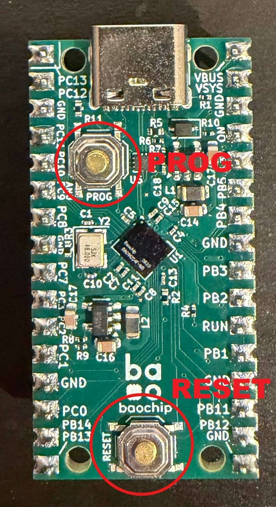
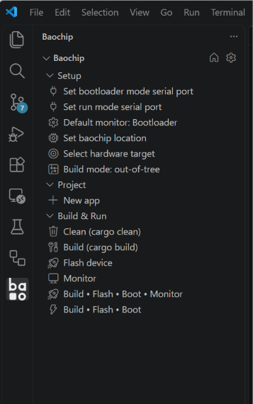
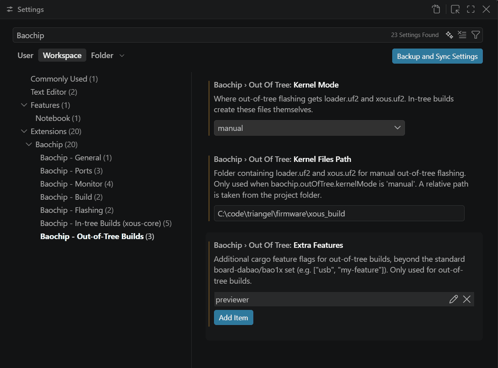
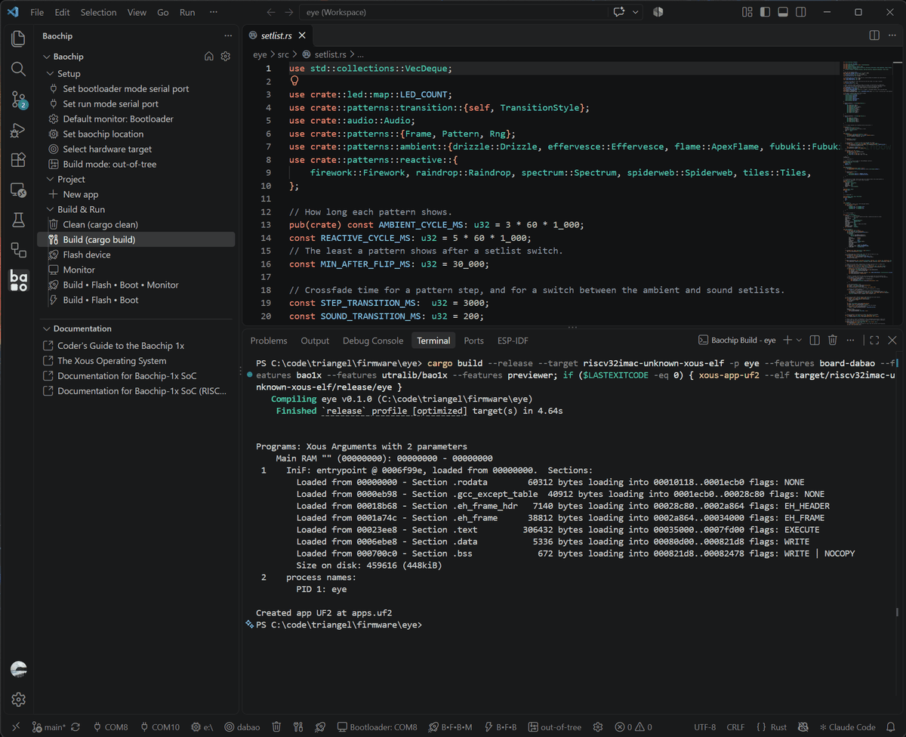
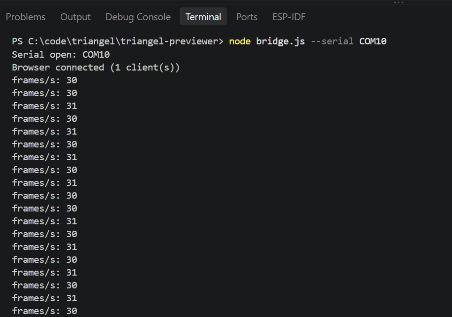
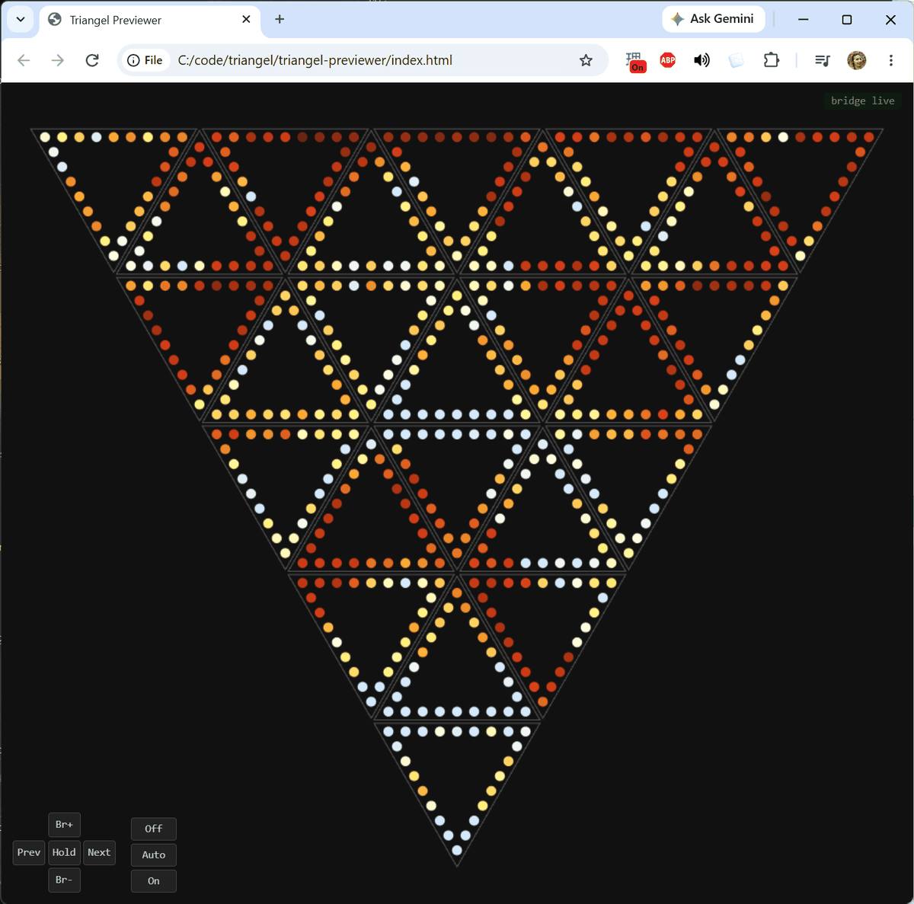

# Your first run

In this tutorial you will put triangel's firmware on a single dabao and watch its patterns in your browser. You do not need any triangle tiles or other boards: the previewer draws all 600 LEDs on the screen.

## Before you start

You need:

- one dabao and a USB-C cable that carries data (some cables only charge)
- a computer set up as in [How to set up a development machine](../how-to/set-up-a-development-machine.md), including Node.js for the previewer



The dabao has two buttons you will use: **RESET** near one end and **PROG** near the USB-C connector.

## 1. Build the eye with the previewer

The eye is the board that draws the patterns. Built with the `previewer` option, it sends each frame to your computer instead of to the triangle tiles.

Open the `firmware/eye` folder in VS Code, and click the Baochip icon in the bar on the left. The Baochip sidebar opens. Every command in this tutorial is there.



Move the mouse over the **Baochip** heading at the top, and a gear icon appears next to it. Click it and set **Extra features** to `previewer`.



Then click **Build (cargo build)** under **Build & Run**.

When it finishes, the output panel shows no errors.



> **From the command line:** from `firmware/eye`, run
>
> ```
> cargo build --release --features previewer
> xous-app-uf2 --elf target/riscv32imac-unknown-xous-elf/release/eye
> ```
>
> The second command writes `apps.uf2`.

## 2. Put the dabao in its bootloader

The bootloader is the small program that accepts new firmware.

Plug the dabao into your computer. A new drive should appear on your computer. If it does not, press **RESET**.

> [!NOTE]
> If the dabao has been set to start its firmware at power-up (with `bootwait disable`, as boards in a finished triangel are), RESET only restarts it. Instead, hold **PROG** while you press **RESET**, or while you plug it in.

> [!NOTE]
> No drive? Try another cable. A charge-only cable powers the board but your computer never sees it.

## 3. Flash the firmware

Click **Flash device** in the Baochip sidebar.

When it finishes, press **PROG** to start the firmware. The drive goes away.

> **From the command line:** copy these onto the drive:
>
> - `firmware/xous_build/loader.uf2`
> - `firmware/xous_build/xous.uf2`
> - `firmware/eye/apps.uf2`
>
> Then press **PROG**.

## 4. Start the bridge

The bridge is a small program that reads frames from the dabao and hands them to the browser.

In a terminal, from `triangel-previewer/`, install its packages. You only do this once:

```
npm install
```

Now find the dabao's serial port. With the firmware running, click **Set run mode serial port** under **Setup** in the Baochip sidebar. The list it shows includes the dabao's port.

> **From the command line:** look for the port here:
>
> | System | Where to look | Looks like |
> |---|---|---|
> | Windows | Device Manager, under **Ports (COM & LPT)** | `COM10` |
> | Linux | `ls /dev/ttyACM*` | `/dev/ttyACM0` |
> | macOS | `ls /dev/cu.usbmodem*` | `/dev/cu.usbmodem1101` |

Start the bridge with that port, for example:

```
node bridge.js --serial COM10
```

It prints `Serial open:` with the port name, then a `frames/s:` line every second. The count should be close to 30.



> [!NOTE]
> The dabao shows a different serial port while it is in its bootloader. If the port you found disappears when you press **PROG**, look again after the firmware starts.

> [!NOTE]
> Only one program can use the port at a time. If the bridge says `Serial open failed`, close any serial monitor that has it open, including the one in the Baochip extension.

> [!NOTE]
> On Linux, if the port will not open, add yourself to the `dialout` group with `sudo usermod -aG dialout $USER`, then log out and back in.

> [!NOTE]
> If the bridge stops with `address already in use`, another program is using port 8080. See [If port 8080 is taken](../how-to/run-the-previewer.md#if-port-8080-is-taken).

## 5. Open the previewer

Open `triangel-previewer/index.html` in your browser.

The status in the corner says `bridge live`, and the triangel lights up with the first pattern.



If the status says `no bridge`, the bridge is not running. If it says `no frames`, the bridge is running but the dabao is not sending: check that the firmware has started.

## 6. Try the controls

The buttons in the lower-left corner do what the buttons on a triangel do:

1. Press **Next** a few times. Each press fades to the next pattern.
2. Press **Prev** to go back.
3. Press **Br-**, then **Br+**, to change the brightness.
4. Press **Hold**. The button stays lit, and triangel stays on this pattern instead of moving on by itself after a few minutes. Press it again to let go.
5. Set the switch to **On**. triangel changes to its sound patterns.

The sound patterns listen to the ear, the second dabao. With no ear connected they see silence. Set the switch back to **Off** to return to the ambient patterns.

## What you did

You built triangel's eye firmware, flashed it onto a dabao, and watched it run in the previewer, the same way you will check your own changes.

Next:

- [Write your first pattern](first-pattern.md)
- [The controls](../../USER_GUIDE.md#controls), in the user guide
- [How to build and flash the boards](../how-to/build-and-flash.md), for the build options and the ear
